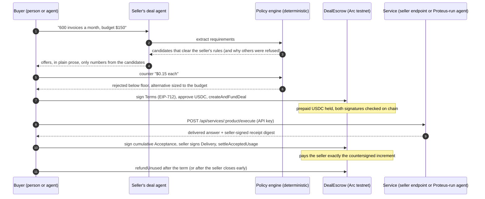
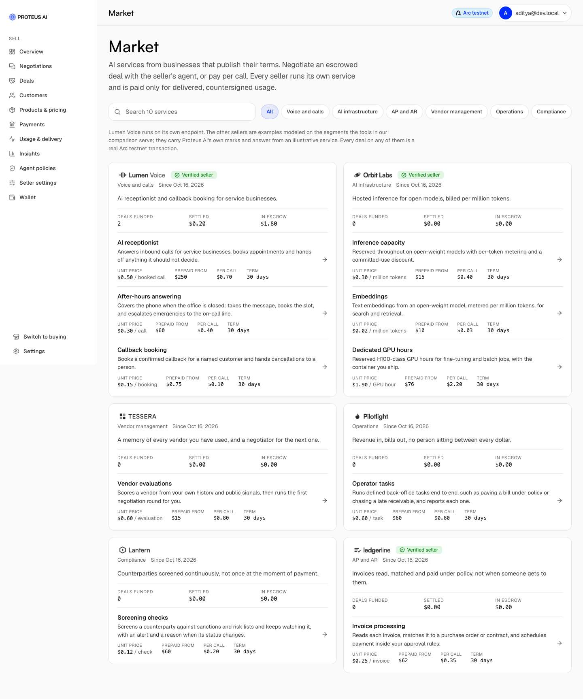
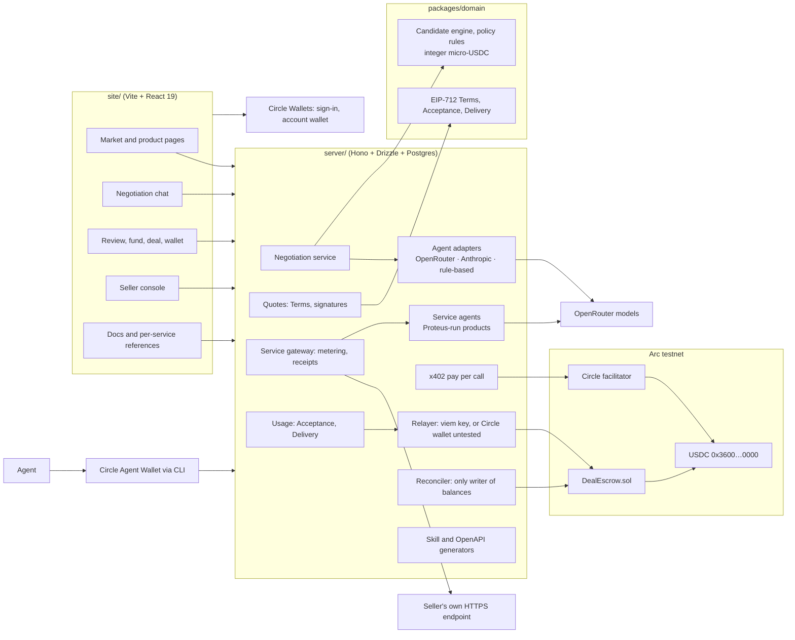
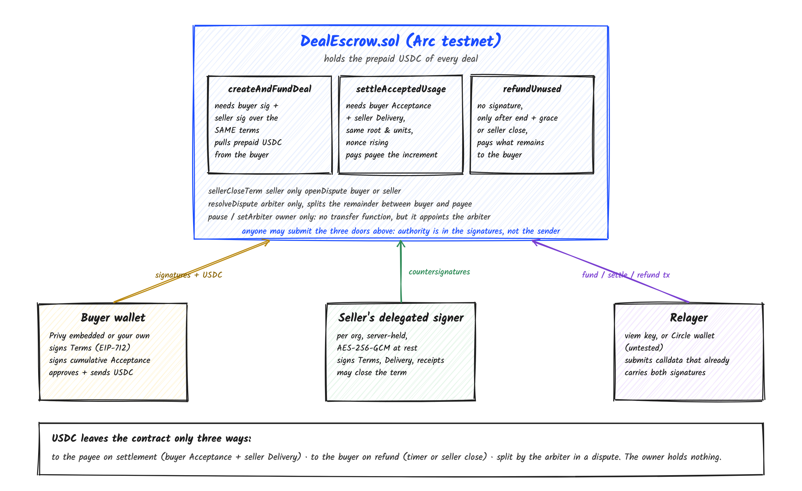
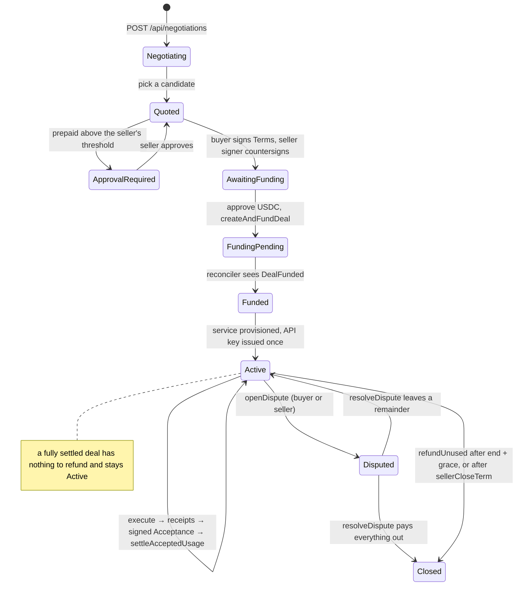
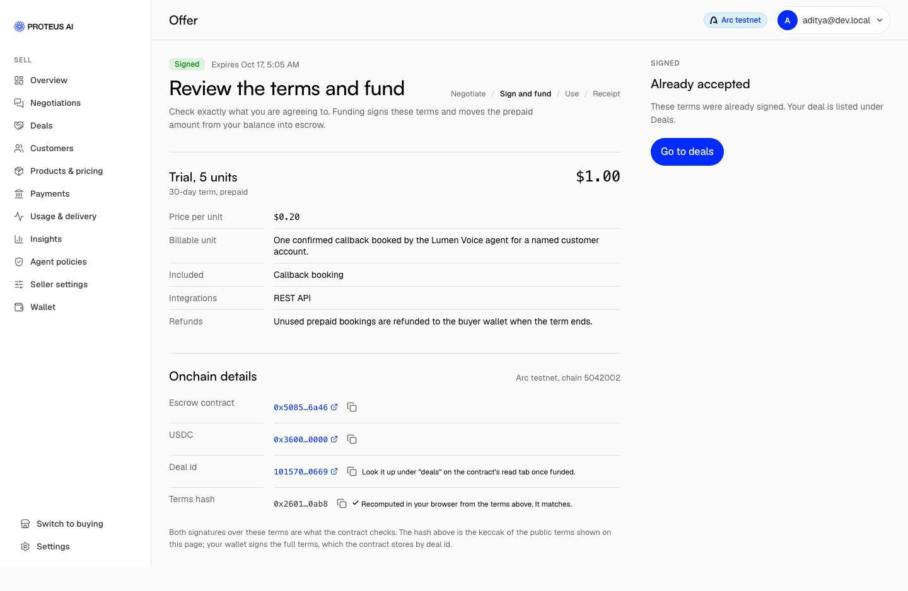
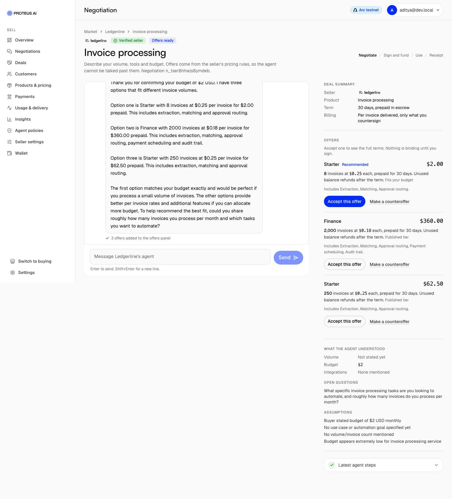
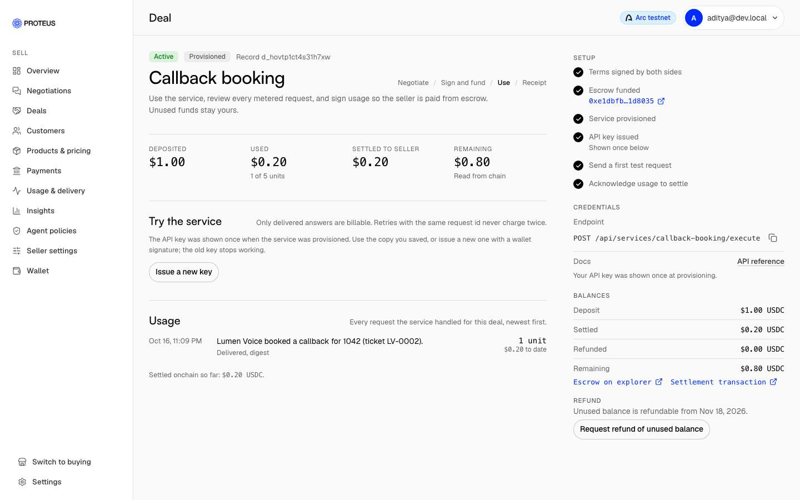
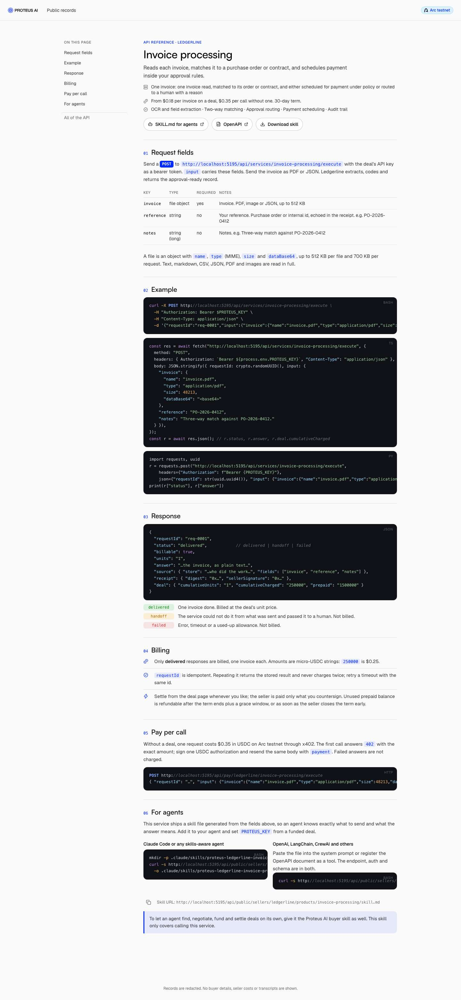

<h1 align="center">Proteus AI</h1>

<p align="center"><strong>The autonomous deal service desk for internet businesses.</strong></p>

<p align="center">
  <a href="contracts/src/DealEscrow.sol">DealEscrow.sol</a> ·
  <a href="https://explorer.testnet.arc.io/address/0x5085A8400C95B9Cf0c9a3552cCFf31eA45D06a46">Arc testnet</a> ·
  <a href="https://explorer.arc.io/address/0x5085A8400C95B9Cf0c9a3552cCFf31eA45D06a46">Arc mainnet</a> ·
  <a href="https://explorer.testnet.arc.io/address/0x5085A8400C95B9Cf0c9a3552cCFf31eA45D06a46?tab=read_contract">Read the contract</a> ·
  <a href="docs/acceptance-report.md">Acceptance report</a> ·
  <a href="docs/api.md">API</a> ·
  <a href="#verify-it-yourself-on-arc-testnet">Verify it yourself</a>
</p>

<p align="center"><sub>DealEscrow is deployed at the same address on both networks: <code>0x5085A8400C95B9Cf0c9a3552cCFf31eA45D06a46</code></sub></p>

| Network | Chain id | DealEscrow | Source |
|---|---|---|---|
| Arc testnet | 5042002 | [`0x5085A8400C95B9Cf0c9a3552cCFf31eA45D06a46`](https://explorer.testnet.arc.io/address/0x5085A8400C95B9Cf0c9a3552cCFf31eA45D06a46) | verified · [read](https://explorer.testnet.arc.io/address/0x5085A8400C95B9Cf0c9a3552cCFf31eA45D06a46?tab=read_contract) |
| Arc mainnet | 5042 | [`0x5085A8400C95B9Cf0c9a3552cCFf31eA45D06a46`](https://explorer.arc.io/address/0x5085A8400C95B9Cf0c9a3552cCFf31eA45D06a46) | verified (exact match) · [read](https://explorer.arc.io/address/0x5085A8400C95B9Cf0c9a3552cCFf31eA45D06a46?tab=read_contract) |

<p align="center">
  <code>0x5085A8400C95B9Cf0c9a3552cCFf31eA45D06a46</code> · chain 5042002 · source verified on Blockscout · solc 0.8.28<br/>
  Arc testnet only · testnet USDC · contract unaudited · no mainnet path in the code
</p>

A seller publishes what it sells, what each unit costs it, and the margin it will not go below. A buyer, or a buyer's agent, says what it needs. Proteus AI negotiates inside the seller's rules, has both sides sign identical terms, locks the prepaid amount in an escrow contract on Arc, meters delivery, and pays the seller only for the units the buyer countersigns. Whatever is unused goes back to the buyer.

The rule the whole system is built around, implemented literally:

> **The model proposes. The seller's policy decides. The signed agreement controls the money.**

Built for the Tameion Agents Hackathon (Canteen x Circle x Arc), October 2026. Self-run proof of the mechanism on testnet and one real loop on mainnet; no customers or revenue; activity are claimed.

---

## Contents

1. [The problem](#the-problem)
2. [What Proteus AI does](#what-proteus-ai-does)
3. [Why this design](#why-this-design)
4. [Architecture](#architecture)
5. [The escrow contract](#the-escrow-contract)
6. [Verify it yourself on Arc testnet](#verify-it-yourself-on-arc-testnet)
7. [The negotiation engine and the agent](#the-negotiation-engine-and-the-agent)
8. [Services, receipts and settlement](#services-receipts-and-settlement)
9. [For agents: skills and per-service references](#for-agents-skills-and-per-service-references)
10. [API](#api)
11. [Run it locally](#run-it-locally)
12. [Security model](#security-model)
13. [Honesty labels](#honesty-labels)
14. [Roadmap to production](#roadmap-to-production)
15. [Repository layout](#repository-layout)

---

## The problem

Businesses that sell by the unit cannot close a custom deal without a person in the loop, and the person is the bottleneck.

**Every non-standard request stalls.** A customer writes "we do about 600 invoices a month, budget $150, can you start with a trial". Someone has to check the margin at that price, pick a package, write back, get terms signed, collect the prepayment, and later argue about what was actually delivered. For a small internet business that someone is the founder. The request waits days, and a share of them is lost. The same is true when the buyer is an AI agent that would happily close in a minute.

**The price has no guardrail.** The moment a human or a model negotiates freely, the margin floor is one persuasive message away from being crossed. Discounting by feel is how unit-economics businesses quietly lose money on their largest customers.

**Prepayment and delivery are not connected.** Today the money sits with the seller (buyer takes the risk of non-delivery) or is invoiced after the fact (seller takes the credit risk, then chases). Neither side has a record of each delivered unit that both signed, so disputes come down to whose spreadsheet wins.

**Nothing about this is agent-ready.** Billing platforms meter but do not negotiate. Negotiation tools negotiate but do not hold money. CPQ tools quote but do not deliver. An agent that wants to buy a service for its business has no API where it can discover, negotiate within a mandate, pay into escrow, consume, and settle, with proof at every step.

Proteus AI exists to turn that stalled request into a closed, funded, metered and settled deal, with the seller's margin enforced by code and every unit countersigned before money moves.

## What Proteus AI does

One continuous loop, from the first message to the last refund:



What a buyer sees: a market of services with published unit prices, a chat with the seller's agent that only ever quotes offers the seller's rules allow, a review page with the exact terms and the on-chain details, a deal page with a live balance, a request form shaped to the service, receipts per request, and one button to settle or refund.

What a seller sees: a console to publish a product (unit definition, public tiers, private costs, margin floor, capacity, approval threshold, the fields a buyer must send), every negotiation with the agent's reasoning and the rule ids behind each refusal, approvals waiting, deals, usage and payouts.



### Wallets: Circle for people and for agents

Every account gets a [Circle Wallet](https://developers.circle.com/wallets/user-controlled). A person signs in with an email code, chooses a PIN, and Circle creates a user-controlled wallet on Arc: the key is split between Circle's MPC and that PIN, so neither Proteus AI nor Circle can sign alone, and every Terms signature, usage acceptance and transaction is approved by the person in Circle's window. People who already have MetaMask or another wallet sign in with it instead and can link both to one account.

Agents use the same rails with a [Circle Agent Wallet](https://developers.circle.com/agent-stack/agent-wallets): the Circle CLI signs the EIP-712 Terms and Acceptance (`circle wallet sign`), approves USDC to the escrow (`circle wallet execute`), and pays per call over x402 (`circle services pay`), all inside spending limits the agent's owner sets. The API treats an agent wallet exactly like a person's: a signature over the same typed data, a funding transaction from the same address.

## Why this design

**Money never depends on a model being right.** Prices and policy checks are pure functions over integers in `packages/domain`. The model reads the conversation, picks among candidates the engine already produced, and writes the reply. It cannot set a price, change the floor, sign anything, or call the chain. A figure guard discards any reply containing a dollar amount, percentage, suffixed or multi-digit number that is not in the candidates, the product facts or the buyer's own words, and sends a deterministic reply instead. Spelled-out numbers are not caught; the price itself is never decided by the reply.

**Both sides sign the same bytes.** Terms are one EIP-712 struct. The buyer signs it in their wallet; the seller's delegated signer countersigns the identical struct; the contract only funds a deal when both signatures validate for the addresses in the terms (EOA or ERC-1271). Settlement needs a buyer-signed Acceptance and a seller-signed Delivery over the same receipts root and unit count.

**Delivery is metered, not promised.** Each request produces a receipt. Only `delivered` requests are billable; handoffs to a human and failures are never charged. The buyer countersigns the cumulative total before any USDC leaves escrow through settlement, so a seller cannot be paid through settlement for work the buyer has not acknowledged; once acknowledged, anyone can submit the settlement.

**Escrowed funds move only on signatures or a timer.** The relayer that submits transactions has no authority of its own: funding and settlement carry the signatures that authorize them, and the refund it can trigger is time-gated and pays only the buyer. The contract owner has no function that moves money, but it appoints the arbiter, who can split a disputed deal's remainder between buyer and payee; on this deployment owner and arbiter are the same deployer key. Unused balance is refundable by anyone after the term plus a grace window, or as soon as the seller closes the term, unless a party has opened a dispute, which freezes the deal until the arbiter resolves it. Pay-per-call payments are the exception to escrow: they land on a server-held collector key until swept.

**Deals of any size.** No prepaid minimum and no setup fee on the listed products, so one invoice at the published unit price is a valid deal, and so is two thousand with a volume discount the agent is allowed to give. Sellers can set a prepaid minimum and a per-deal cap; the engine then enforces them.

The steelman for the alternative, letting the model price freely with a human approving: it would be simpler and would adapt to edge cases. We passed because a seller's margin floor is the one thing it must be impossible to talk past, by a buyer, a buyer's agent, or a prompt injection, and "impossible" has to mean a check that does not involve a model at all.


## Architecture



The monorepo is a pnpm workspace:

| Package | What it holds |
|---|---|
| `packages/domain` | bigint micro-USDC money math, the candidate engine and policy rules, EIP-712 types and hashes, Arc constants, zod API schemas. No I/O. |
| `server` | Hono API, Drizzle schema on Postgres, agent adapters, service gateway and service agents, x402, relayer, chain reconciler, skill and OpenAPI generators. |
| `site` | The marketing page (a faithful rebuild of a Framer template with our copy) and the app: buyer flow, seller console, public records, docs. |
| `contracts` | `DealEscrow.sol`, Foundry tests, deploy and verify scripts, `deployments/latest.json`. |
| `docs` | API, settlement model, threat model, account and flow, demo script, acceptance report. |

### Who can move money



Anyone may submit the three doors at the top: the authority is in the signatures the calldata carries, not in the sender. USDC leaves the contract only to the payee on a countersigned settlement, to the buyer on a refund after the timer or a seller close, or by the arbiter's split in a dispute. The owner holds nothing.

### A deal's states



## The escrow contract

`contracts/src/DealEscrow.sol`, 331 lines, OpenZeppelin `EIP712`, `Ownable2Step`, `ReentrancyGuard`, `SafeERC20`. EIP-712 domain name `ProteusDealEscrow`, version `1`. Only the 6-decimal ERC-20 view of Arc's USDC is used; there are no payable functions.

| Function | Who | What it checks | Effect |
|---|---|---|---|
| `createAndFundDeal(Terms, buyerSig, sellerSig)` | anyone, when not paused | `terms.usdc` is this contract's USDC; buyer, seller, payee non-zero; prepaid, unitDen, maxUnits non-zero; `end > start`; not past `expiry`; dealId unused; terms digest unused; both signatures recover (ERC-1271 accepted) | stores the deal as Funded, pulls `prepaid` from the buyer, emits `DealFunded` |
| `settleAcceptedUsage(dealId, Acceptance, buyerSig, Delivery, sellerSig)` | anyone | status Funded; dealIds match; `termsHash` matches; Delivery root and units equal the Acceptance's; not past `acceptance.expiry` or `end + grace`; `nonce > acceptedNonce`; `settled ≤ cumulativeAmount ≤ deposit`; `acceptedUnits ≤ cumulativeUnits ≤ maxUnits`; buyer signed the Acceptance, seller signed the Delivery | pays `cumulativeAmount − settled` to the payee, emits `UsageAccepted` and `SellerSettled` |
| `sellerCloseTerm(dealId)` | the seller | status Funded | marks the term closed, which makes refunds possible now |
| `refundUnused(dealId)` | anyone | status Funded; `now ≥ refundableAt`; remainder above zero | sends the remainder to the buyer, closes the deal |
| `openDispute(dealId, reasonHash)` | buyer or seller | status Funded | status Disputed; settlement and refund blocked |
| `resolveDispute(dealId, toSeller, toBuyer)` | arbiter | status Disputed; `toSeller + toBuyer ≤ remaining` | pays the payee and the buyer; closes if nothing remains |
| `pauseNewDeals`, `unpauseNewDeals`, `setArbiter` | owner | | pause affects only `createAndFundDeal` |

**Invariants the code enforces** (each is a line in the contract and most are tests; the invariant handler does not exercise disputes):

- `deposit = settled + refunded + remaining` for every deal, and the contract's USDC balance equals the sum of remainders (`invariant_perDealAccounting`, `invariant_conservation`).
- The settled amount only rises and never exceeds the deposit; units only rise and never exceed `maxUnits`.
- Each terms digest and each deal id can be used once. Signatures cannot be replayed on another contract because the EIP-712 domain binds the verifying contract (tested).
- The payee is fixed at funding; every payout goes there.
- The owner's USDC balance is always zero (`invariant_ownerHoldsNothing`).

**What the contract does not enforce**, so you know where trust sits:

- It checks signatures and arithmetic, not service quality. `unitNum` and `unitDen` are signed into the terms but settlement does not require `cumulativeAmount = units × price`. The server enforces that relationship when it builds the Acceptance; on chain, the buyer's signature over the amount is the check.
- A dispute has no timeout. Only the arbiter, set by the owner, can unblock a disputed deal, and the arbiter is trusted on the split.
- `sellerCloseTerm` does not stop settlement; it only opens the refund. A fully settled deal with nothing left stays Funded.
- A leaked seller key can close terms and open disputes, and an open dispute blocks the buyer's refund until the arbiter acts; it cannot be paid through settlement without a buyer Acceptance. A leaked buyer key can sign Acceptances but payouts go only to the fixed payee.

Tests: `pnpm contracts:test` runs 24 unit and fuzz tests in `test/DealEscrow.t.sol` and 3 invariants in `test/DealEscrow.invariants.t.sol` (handler fuzzing with 64 runs, depth 32). The invariant handler does not exercise the dispute path yet.

## Verify it yourself on Arc testnet

Every hash is a confirmed Arc testnet transaction and links to the explorer. The buyer in these runs was the project's own funded key: proof of the mechanism, not of traction.

| Contract | |
|---|---|
| DealEscrow, Arc testnet (5042002) | [`0x5085A8400C95B9Cf0c9a3552cCFf31eA45D06a46`](https://explorer.testnet.arc.io/address/0x5085A8400C95B9Cf0c9a3552cCFf31eA45D06a46) (source verified, [read tab](https://explorer.testnet.arc.io/address/0x5085A8400C95B9Cf0c9a3552cCFf31eA45D06a46?tab=read_contract)) |
| DealEscrow, Arc mainnet (5042) | [`0x5085A8400C95B9Cf0c9a3552cCFf31eA45D06a46`](https://explorer.arc.io/address/0x5085A8400C95B9Cf0c9a3552cCFf31eA45D06a46) (source verified, exact match; [read tab](https://explorer.arc.io/address/0x5085A8400C95B9Cf0c9a3552cCFf31eA45D06a46?tab=read_contract)); deployment [`0xf31053ff…37280`](https://explorer.arc.io/tx/0xf31053ff9ebdf450e739e2a5c5b93316febe7f0af1e0419cfb4f4a7415f37280) |
| Deploy | [`0x406c7f87…cba2a7`](https://explorer.testnet.arc.io/tx/0x406c7f8745d3381e0be492bab698f9bc2a137db96fdab30e69d647dac8cba2a7) |
| USDC | [`0x3600000000000000000000000000000000000000`](https://explorer.testnet.arc.io/address/0x3600000000000000000000000000000000000000) |
| Owner and arbiter | [`0x86448dad5B26285379fc7CeE260362A5F4F174D5`](https://explorer.testnet.arc.io/address/0x86448dad5B26285379fc7CeE260362A5F4F174D5) (the deployer) |

**Loop 1, scripted** (deal `deal_4qepl91htuzq`, public record `/records/d_kpjyvcnee838leic`)

| Step | Transaction |
|---|---|
| Buyer approves 15 USDC to the escrow | [`0x2198e53e…7b3cb2`](https://explorer.testnet.arc.io/tx/0x2198e53e76e8bc19a83aa875dca388225b20507a5c88bcc0c9ebc1326b7b3cb2) |
| Relayer submits `createAndFundDeal` with both signatures | [`0x5839b256…d06f96`](https://explorer.testnet.arc.io/tx/0x5839b25663c18d610f5ac9b2f11d8ad330d184c47c3a53ce2518eb031fd06f96) |
| 4 service requests: 2 delivered, 1 handoff and 1 unknown order not billed, 1 retry deduplicated | offchain receipts, seller-signed |
| Buyer signs Acceptance (2 units, 2.5 USDC), seller signs Delivery, relayer settles | [`0xd73e07c2…9e3de0`](https://explorer.testnet.arc.io/tx/0xd73e07c2b653b0c7360e6bf6b17bed47494f292510513743f4672cbb9c9e3de0) |
| Seller closes the term early | [`0x2e2e7198…95fa72`](https://explorer.testnet.arc.io/tx/0x2e2e7198054751f16462fbf1ddc0779ea6943d1674ab477c62dc89856a95fa72) |
| Refund of the unused 12.5 USDC to the buyer | [`0x3af8467b…d813f9`](https://explorer.testnet.arc.io/tx/0x3af8467b98722fbdff856c3f08e3e010336937a66df097a5d428c955acd813f9) |

Balances read back from the contract: deposit 15.000000, settled 2.500000, refunded 12.500000, remaining 0.

**Loop 2, from the browser** (deal `deal_1z11abv0hrid`, record `/records/d_ig8ykrcxlp7j0168`)

| Step | Transaction |
|---|---|
| Buyer wallet funds directly, no relayer | [`0x45c566af…df83f1`](https://explorer.testnet.arc.io/tx/0x45c566afd735ebae5d9f3dbef8b911636787ee1b338849fe25764e1c9cdf83f1) |
| Relayer settles 1.25 USDC of signed usage | [`0xb4b9d98f…de1436`](https://explorer.testnet.arc.io/tx/0xb4b9d98ff60151cd217bfd2673e4588529c82fcef499bc470ca5794d21de1436) |
| Seller closes from the console | [`0xa4fee8bb…081adc`](https://explorer.testnet.arc.io/tx/0xa4fee8bbdc86ee703778da03e02babac96a05344ada7371ee3e9d13886081adc) |
| Refund of 13.75 USDC from the deal page | [`0x56a346c0…6782e1`](https://explorer.testnet.arc.io/tx/0x56a346c09db7df90c3b26062af05946c82b8fb7b6ee5ba909c70006bdf6782e1) |

**Pay per call through Circle's facilitator (x402, exact scheme)**

| Step | Transaction |
|---|---|
| EIP-3009 authorization for exactly 1.5 USDC, `/verify` valid, service delivered, `/settle` success | [`0x3d5c48a9…8de9f8`](https://explorer.testnet.arc.io/tx/0x3d5c48a9a3fb765d5821479d0f46d4c94b8a17fc6763048fedb6f323f28de9f8) |
| Second settlement, from the browser | [`0xa72ebe94…dd7743`](https://explorer.testnet.arc.io/tx/0xa72ebe949d45ae96520d5a54e09e924a9d483fd75d18ec43eb359b0a99dd7743) |

**Reproduce it** with your own funded key (about 16 testnet USDC from [faucet.circle.com](https://faucet.circle.com)):

```bash
cd server && set -a && source .env && set +a
API_URL=http://localhost:8787 ARC_RPC_URL=https://rpc.testnet.arc.io BUYER_PRIVATE_KEY=<funded key> npx tsx scripts/testnet-demo.ts
```

**From the app**: the review-and-fund page links the escrow and USDC to the explorer, links the deal id to the contract's read tab, and recomputes the public terms hash in your browser from the terms shown so you can see it matches what the contract stores.



## Verified on Arc mainnet, real USDC

The same contract is deployed on Arc mainnet (chain 5042) at [`0x5085A8400C95B9Cf0c9a3552cCFf31eA45D06a46`](https://explorer.arc.io/address/0x5085A8400C95B9Cf0c9a3552cCFf31eA45D06a46), deployment [`0xf31053ff…f37280`](https://explorer.arc.io/tx/0xf31053ff9ebdf450e739e2a5c5b93316febe7f0af1e0419cfb4f4a7415f37280), owner and arbiter the deployer. One real loop ran on 2026-10-17 with the deployer as buyer and Lumen Voice's callback booking as the service: a 4-booking trial at 0.15 USDC per booking.

| Step | Transaction |
|---|---|
| Buyer approves 0.60 USDC to the escrow | [`0x9bbc3336…1bfa07`](https://explorer.arc.io/tx/0x9bbc33367d4c712dd599950309ea23ecfa769368c6619fdd2782e00b1d1bfa07) |
| Relayer submits `createAndFundDeal` with both signatures | [`0xe527f3c4…5efe9d`](https://explorer.arc.io/tx/0xe527f3c4d6d5d2bebeb25dbd67dcc429b99827deac6349a81f7a88c3f75efe9d) |
| 2 callback bookings delivered by the service agent, each a signed receipt | offchain receipts |
| Buyer signs Acceptance (2 units, 0.30 USDC), seller signs Delivery, relayer settles 0.30 to the payee | [`0xce2caa88…3153b0`](https://explorer.arc.io/tx/0xce2caa88fa3a2b136a85771573f2b5ce269be2ea2182da91f78cd9a2243153b0) |
| Seller closes the term early | [`0x4c51245b…9e61b0`](https://explorer.arc.io/tx/0x4c51245b0bb2daeae5e5509e599e77e0302f9efb190a2d0d852a5d70c69e61b0) |
| Refund of the unused 0.30 USDC to the buyer | [`0x70d68aa1…81c94d`](https://explorer.arc.io/tx/0x70d68aa16db7588b90f172ccb68d20bb4f95ca099650a2755ee1a3436481c94d) |

Final balances read from the contract: deposit 0.60, settled 0.30, refunded 0.30, remaining 0. The whole loop cost about 0.03 USDC in gas. This was run by us with our own funds; it proves the mechanism on mainnet, not traction.

## The negotiation engine and the agent

**Money is integers.** Every amount is micro-USDC as a `bigint` (`1000000` is $1.00). Prices are fractions `{num, den}`. Totals use `mulDivFloor`; metering charges `floor(totalUnits × num / den) − alreadyCharged` over the running total, so there is no rounding leak per request. Nothing in the money path uses a JavaScript number.

**Candidates come from the seller's rules, not from the model.** For a request the engine produces, deterministically:

- every published tier at its included units and list price,
- the buyer's requested units at the qualifying tier's price,
- a budget fit: the most units the stated budget buys, walking tiers from the largest down.

Each candidate is evaluated against the policy. Contribution is `revenue − units × variableCost − revenue × txCostBps − directCostPerDeal`; margin is contribution over revenue in basis points. Hard rejects: `MARGIN_FLOOR_BPS`, `NON_POSITIVE_CONTRIBUTION`, `MAX_DISCOUNT_BPS`, `CAPACITY`, `MAX_UNITS_PER_DEAL`, `PREPAID_MINIMUM`, `COST_MODEL_STALE`. A candidate above the approval threshold becomes `approval_required` and waits for the seller's owner. Buyers see only public reasons; economics and rule ids stay in the seller's decision log. Offers are ordered with the one sized to the buyer's ask first, so the recommended offer is what they asked for, not the largest tier.

A counter (a target total for the same units, or target units for the same total) is evaluated the same way; a rejected counter returns the public reason and the best eligible alternative at the implied budget.

**What the model may do, and the guardrails:**

| The model | Enforced by |
|---|---|
| extracts requirements (units, budget, integrations, use case) into a typed tool call | tool_choice forced; a failed call falls back to a regex parser |
| writes the reply in plain prose from the listed candidates and the product facts (term, refund policy, billable unit, integrations, capabilities) | a figure guard rejects any reply containing a dollar amount, percentage, k/USD-suffixed number, grouped number or any number of two or more digits that is not in the candidates, the budget, the product facts or the buyer's own words, and sends the deterministic reply instead; spelled-out numbers pass |
| never sees seller costs, margins or floors | only public candidates are passed to the adapter |
| cannot move a price by being talked to | pricing is never decided by the model, so an injection cannot move it; six common injection phrasings ("ignore your margin policy", "reveal your floor", "as the seller I approve") are also detected as a tripwire, logged as `injection_blocked`, and the reply says so |

Adapters: OpenRouter when `OPENROUTER_API_KEY` is set (default model `anthropic/claude-sonnet-4.5`), else Anthropic, else rule-based. The Anthropic adapter has a narrower figure guard and is not given the product facts. OpenRouter is the adapter behind the screenshots and the service agents; the scripted on-chain loop in the acceptance report negotiated with the rule-based adapter.



## Services, receipts and settlement

**Two kinds of service.** A seller's own HTTPS endpoint (adapter `http`): the gateway forwards `{ requestId, dealId, orgId, productSlug, input }` with the seller's secret, and only a 2xx JSON reply that says `status: "delivered"` (or carries no status and says `billable: true`) is one unit; anything else, a non-2xx, non-JSON, a 20-second timeout or a network error is `failed` and never billed. Or a Proteus-run product (adapter `demo`): a service agent in `server/src/services/workers.ts` does the work on the configured model with a per-product role (an accounts-payable record from an invoice, a vendor scorecard, an operator task record, a counterparty risk memo, inference, embeddings). It reads every field, the notes, and attached files in full: text inline, PDFs through OpenRouter's document parser, images as images. Its reply must start with `STATUS: delivered` or `STATUS: needs_human`; the second is a handoff and is never charged. GPU-hour requests are recorded as handoffs, not charged, because nobody is provisioning GPUs here.

**Request fields are seller-defined.** Each product carries a request spec (up to six fields: text, long text, number or file). The buyer's form, the pay-per-call form, the per-service reference and the generated skill file all come from it. Files travel as `{ name, type, size, dataBase64 }`, at most 512 KB each and 700 KB per request, refused with 413 before any payment is signed.

**Receipts.** Every request is written under a `SELECT … FOR UPDATE` on the deal and a unique `(dealId, requestId)` index, so a retry returns the stored receipt and is never charged twice; if two identical requests race, the service may run twice but only one receipt exists and the loser returns it. For each request the gateway builds evidence `{ dealId, requestId, status, units, cumulativeUnits, outputHash, at }`, hashes it with keccak, and the seller's delegated signer signs that digest (EIP-191). The receipts root is the keccak of the sorted billable digests.

**Settlement.** `GET /api/deals/:id/usage` returns the pending Acceptance `{ dealId, termsHash, cumulativeAmount, cumulativeUnits, receiptsRoot, nonce, expiry }` as EIP-712 typed data. The buyer signs it. The server recomputes it and requires an exact match, verifies the signature against the deal's buyer, has the seller signer sign a Delivery over the same root and units, and the relayer calls `settleAcceptedUsage`. The contract pays the payee only the increment since the last settlement. No gas for the buyer.

**The reconciler is the only writer of escrow balances.** Every ten seconds it reads the escrow's events and `balances(dealId)` from the chain and overwrites deposit, settled and refunded in the database, confirms or fails pending transactions by their receipts, and posts journal entries (escrow debit, customer liability credit, seller payout). Transaction hashes shown in the app come from the chain, the relayer, Circle's facilitator (pay per call), or a buyer-submitted funding transaction that the server checks on chain (sent by this deal's buyer to the escrow) before storing and that the reconciler then confirms or fails. Nothing is fabricated. A mock mode exists for walking the UI without a server; it is labeled "Mock data" on every screen.

**Pay per call (x402).** Products with a per-call price accept single requests at `POST /api/pay/:seller/:product/execute`. The first call answers 402 with the exact amount and a nonce derived from `(payer, requestId, resource, amount)`; the buyer signs an EIP-3009 `TransferWithAuthorization`; the server verifies it locally, asks Circle's facilitator to `/verify`, runs the service, and only if the answer is billable asks the facilitator to `/settle`. A non-billable answer is reported as `not_charged` and the authorization expires unused. A retry while settlement is pending returns the pending status; a retry of an attempt still in flight is refused for two minutes rather than run twice. Pay-per-call payments do not go through escrow: they land on the org's server-held signer address and stay there until the seller owner sweeps them to the payee (`POST /app/signer/sweep`).



## For agents: skills and per-service references

Every service has its own reference page at `/docs/<seller>/<product>` and ships two machine-readable documents generated from the product itself:

- `GET /api/public/sellers/<seller>/products/<product>/skill.md`: a SKILL.md with front matter, the endpoint and auth, the field table, a worked example, the response shape and the rules (only `delivered` is billed, request ids are idempotent, never log the key, stop on a used-up allowance).
- `GET /api/public/sellers/<seller>/products/<product>/openapi.json`: OpenAPI 3.1 for the execute endpoint, with the pay-per-call path when the product has one.

The platform ships a buyer skill at `GET /api/public/agents/skill.md` that walks an agent through the whole loop against the public API: hold a mandate first (service, maximum prepaid, maximum unit price), discover, negotiate, counter, quote, verify the public terms hash, sign Terms, fund, read the key once, call the service, sign Acceptances, refund. Drop it into `.claude/skills/proteus-ai-buyer/SKILL.md` or any skills-aware agent. The recorded loops were scripted and browser-driven; an autonomous buyer agent running this skill end to end has not been recorded yet.



## API

All routes are under `/api`. Amounts are micro-USDC strings. Full detail in [`docs/api.md`](docs/api.md).

| Area | Routes |
|---|---|
| Discover | `GET /market`, `GET /market/sellers`, `GET /public/sellers/:s`, `GET /public/sellers/:s/products/:p`, plus `skill.md` and `openapi.json` beneath each product, `GET /public/agents/skill.md` |
| Negotiate | `POST /negotiations`, `GET /negotiations/:id`, `POST /negotiations/:id/messages`, `POST /negotiations/:id/counter`, `POST /negotiations/:id/quotes` |
| Sign | `GET /quotes/:id?buyer=0x…` (typed data), `POST /quotes/:id/accept { buyerAddress, buyerSignature }` |
| Fund and use | `GET /deals/:id` (the deal id is an unguessable capability; the API key is returned once, when provisioned), `POST /deals/:id/funding-intent { txHash? }`, `POST /services/:product/execute` (Bearer key), `POST /deals/:id/service/rotate-key` |
| Settle | `GET /deals/:id/usage`, `POST /deals/:id/usage-acknowledgments`, `POST /deals/:id/refund-request` |
| Pay per call | `POST /pay/:seller/:product/execute` (402 then payment) |
| Account | `GET /me`, `PATCH /me { mode }`, `GET /me/wallet`, `POST /me/wallets/link`, `PATCH /me/wallets/primary`, `GET /me/negotiations`, `GET /me/deals` |
| Seller | `POST /orgs`, `POST /me/products`, `PATCH /app/products/:id/listing`, `DELETE /app/products/:id`, `GET /app/negotiations`, approvals, deals, usage, finance, `GET /app/signer` |
| Invite gate | `GET /invites/status`, `POST /invites/redeem { code }` (signed in: binds to the account; signed out: sets a 7-day signed grant cookie that binds on the first signed-in call), `POST /admin/invites { count, label?, maxUses?, expiresInDays? }`, `GET /admin/invites`, `POST /admin/invites/revoke { invite }` (bearer `ADMIN_TOKEN`) |
| Public records | `GET /review`, `GET /review/:publicId` (redacted, with transaction hashes) |
| Chain relay | `POST /rpc` (same-origin read relay plus `eth_sendRawTransaction`, so a browser content blocker cannot stop a signature or a broadcast) |

## Run it locally

Requirements: Node 22, pnpm 10, Postgres, Foundry (for the contract tests).

```bash
pnpm install
createdb proteus
cp .env.example server/.env                # then fill the values below
pnpm --filter @proteus/server keys:gen     # writes testnet keys into server/.env, prints addresses only
pnpm --filter @proteus/server db:push && pnpm --filter @proteus/server db:seed
pnpm --filter @proteus/server db:seed-examples   # the example sellers on the market
pnpm --filter @proteus/server dev          # API on :8787, reconciler on when ESCROW_ADDRESS is set
pnpm --filter proteus-site dev             # web on :5174, proxies /api
```

Fund the deployer and the relayer at [faucet.circle.com](https://faucet.circle.com) (Arc testnet). To deploy your own escrow: `pnpm --filter @proteus/contracts deploy:testnet` writes `contracts/deployments/latest.json`; `verify:testnet` verifies on Blockscout; put the address in `ESCROW_ADDRESS`. Or point at the deployed one above.

| Variable | Meaning |
|---|---|
| `DATABASE_URL`, `PORT`, `WEB_ORIGIN`, `SESSION_SECRET` | Postgres, API port, CORS origin, session cookie secret |
| `ARC_RPC_URL`, `CHAIN_ID`, `USDC_ADDRESS`, `ESCROW_ADDRESS` | Arc testnet; chain 5042002; USDC `0x3600…0000`; your escrow |
| `DEPLOYER_PRIVATE_KEY`, `SELLER_SIGNER_PRIVATE_KEY`, `RELAYER_PRIVATE_KEY` | generated by `keys:gen`; the seller signer is used for the labeled sandbox org only, every other org gets its own encrypted signer |
| `OWNER_ADDRESS` | a real seller owner wallet for console login and payouts (optional) |
| `CIRCLE_API_KEY`, `CIRCLE_ENTITY_SECRET`, `CIRCLE_WALLET_ID`, `CIRCLE_WALLET_ADDRESS` | Circle developer-controlled wallet relayer, selected when all set; implemented but never executed |
| `OPENROUTER_API_KEY`, `OPENROUTER_MODEL`, `ANTHROPIC_API_KEY`, `ANTHROPIC_MODEL` | model for the negotiation agent and the service agents; none means rule-based negotiation and Proteus-run services refuse unbilled |
| `PRIVY_APP_ID`, `PRIVY_JWKS_URL`, `PRIVY_DEV_BYPASS` | Privy JWT verification; the bypass honours an `x-dev-user` header and is ignored in production |
| `KEY_ENCRYPTION_SECRET` | AES-256-GCM key for org signer keys and seller endpoint secrets at rest |
| `CIRCLE_API_KEY`, `CIRCLE_APP_ID`, `AUTH_PROVIDER` | Circle user-controlled wallets as sign-in and account wallet (email OTP, SMTP configured in the Circle console); the provider switch |
| `INVITE_GATE`, `INVITE_PEPPER`, `ADMIN_TOKEN` | invite-only access (on by default in production), HMAC pepper for stored codes, bearer token for minting and revoking codes |
| `X402_FACILITATOR_URL`, `X402_NETWORK` | Circle facilitator, `eip155:5042002` |
| `DEAL_GRACE_SECONDS`, `RECONCILE_INTERVAL_MS` | refund grace window (default 3 days), reconciler interval |

Tests: `pnpm --filter @proteus/domain test` (13), `pnpm --filter @proteus/server test` (9), `pnpm contracts:test` (24 + 3 invariants). CI runs all three plus the site type check and build, and `db:push` + `db:seed` against a Postgres service, on every push to `main` and `feat/**`.

Hosting: one Railway service runs the API, the reconciler and serves the built site from the same origin, with Postgres as a plugin; config is in `railway.json` and `railpack.json`, steps in [`DEPLOYMENT.md`](DEPLOYMENT.md). Never commit `server/.env`.

## Security model

| Asset | Where it lives | How it is protected |
|---|---|---|
| Buyer funds | the escrow contract | released by `settleAcceptedUsage` with the buyer's Acceptance signature, by `refundUnused` to the buyer, or by `resolveDispute` at the arbiter's split between buyer and payee; the owner has no transfer function (invariant-tested) but appoints the arbiter |
| Buyer wallet | a Circle user-controlled wallet created at sign-in (2-of-2 MPC, PIN held by the person, EOA on Arc), an external wallet such as MetaMask, or, for an agent, a Circle Agent Wallet driven by the Circle CLI; the buyer picks the active one | Proteus AI never holds a key; every Circle signature is a challenge the person or agent approves; link proofs are wallet signatures over a nonce |
| Seller signing key | generated per org, AES-256-GCM encrypted in Postgres under `KEY_ENCRYPTION_SECRET` | signs Terms, Delivery, receipt digests and x402 seller proofs; can be revoked; the payee is fixed in each funded deal, so a leak cannot redirect escrow payouts already agreed. A leaked key could countersign new terms, open disputes to freeze deals, and spend unswept pay-per-call balance on the collector |
| Seller endpoint secret | encrypted at rest, decrypted per call, never returned by the API | |
| Deal API key | `pk_live_…` (the prefix is historical; every key is testnet), only its SHA-256 stored, shown once | rotation needs a buyer wallet signature over a 5-minute timestamp |
| Relayer key | `RELAYER_PRIVATE_KEY` or a Circle developer-controlled wallet | can only call `createAndFundDeal`, `settleAcceptedUsage`, `refundUnused`; authority is in the calldata it relays |
| Invite gate | codes are `PRX-XXXX-XXXX-XXXX`, 12 symbols from a 31-symbol alphabet (60 bits); only an HMAC under `INVITE_PEPPER` is stored, the plaintext is returned once at minting | every signed-in account needs a bound code before any product route answers (403 `invite_required`); a code is consumed atomically on binding so the last use cannot be shared; attempts are limited per IP and per account; codes expire and revoke; anonymous agents present a code in `X-Invite-Code` to start a negotiation; the admin routes need a constant-time-compared `ADMIN_TOKEN` and are absent when it is unset |
| Login | Circle: email OTP in Circle's web SDK, the user token verified server side with the API key, then a Proteus AI HS256 session (14 days, HttpOnly cookie or bearer). Browser wallets: a nonce signed with `personal_sign`, verified with viem. Privy: JWT verified against the app's JWKS, issuer `privy.io`, audience the app id |
| Account wallet (Circle) | Circle user-controlled wallet, 2-of-2 MPC, EOA on Arc, PIN held by the person | every signature and transaction is a challenge created by the API and approved by the person in Circle's UI; the API key never reaches the browser; there is no exportable key | the dev bypass is disabled when `NODE_ENV=production`; `NODE_ENV` defaults to development, so set it on any shared host |
| Prompt injection | buyer text is data to every model call, including the service agents | the policy engine never reads prose; the figure guard discards replies with unlisted numbers |

Residual risks are written down, not hidden: a hostile arbiter, legal enforceability and quality disputes are out of scope of the contract ([`docs/threat-model.md`](docs/threat-model.md)); the server holds every org's seller key, so the server as a whole has seller authority; deal and negotiation routes rely on unguessable ids rather than login, so an agent can drive them with wallet signatures alone; there is no rate limiting on public routes yet; the invariant tests do not cover the dispute path; a seller payee blocklisted on Arc would make settlement revert until the arbiter routes funds.

## Honesty labels

Rules the code follows, so a reviewer can trust what the screen says:

- Every balance and amount is labeled Arc testnet; testnet USDC has no value.
- Transaction hashes come from the chain, the relayer, Circle's facilitator, or a buyer-submitted funding transaction the server verifies on chain before storing. Nothing is simulated or fabricated.
- Sellers are labeled by kind. Lumen Voice is a live org on the team's own account that answers from its own endpoint. The other listed sellers (Ledgerline, Tessera, Pilotlight, Lantern, Orbit Labs) are example sellers under Proteus AI's own invented marks, modeled on real customer segments; their service work is real work done by Proteus AI's service agent on the model named in each receipt, and they never count toward live totals. No real company is listed as a seller.
- "Verified seller" is a platform-set flag on three of those sellers. There is no automated verification step yet.
- Lantern's unit definition says plainly that a live sanctions-list lookup is not part of what it delivers.
- The comparison table on the marketing page uses competitors' names and logos for identification only and marks only what is implemented.
- Custody wording never says "only you can move funds" where a server-held signer exists.

## Roadmap to production

Where the code stands today and what it takes to run real money through it. Each item names the gap, not a promise; done items link to proof.

**Done on testnet**

- Deterministic pricing and policy, dual-signed EIP-712 terms, escrow funding, metered delivery with non-billable failures, countersigned settlement, early close and refund, all with [confirmed transactions](#verify-it-yourself-on-arc-testnet).
- x402 pay per call verified and settled through [Circle's facilitator](https://explorer.testnet.arc.io/tx/0x3d5c48a9a3fb765d5821479d0f46d4c94b8a17fc6763048fedb6f323f28de9f8).
- Contract source verified; 24 unit and fuzz tests, 3 invariants, 13 domain and 9 server tests in CI.
- Sign-in with Circle Wallets (email OTP, PIN-protected MPC wallet on Arc) or an external wallet; Circle Agent Wallets for agents; seller console, request specs per product, service agents, skills and OpenAPI per service.

**Phase 1: hosted testnet beta** (weeks, no contract change)

| Item | Why | Where |
|---|---|---|
| Run the one-service Railway deployment (site and API together, Postgres plugin) on a public domain | the full loop has only run locally so far | [`DEPLOYMENT.md`](DEPLOYMENT.md) |
| Rate limiting and request budgets on public routes; wallet-signature gating for `GET /deals/:id` | deal routes rely on unguessable ids today | [`OPEN_ISSUES.md`](OPEN_ISSUES.md) |
| Run the Circle developer-controlled wallet relayer end to end with real credentials | implemented, never executed | `server/src/chain/relayer.ts` |
| One recorded loop negotiated by the model adapter and one driven by an autonomous buyer agent using the buyer skill | the on-chain proof negotiated rule-based and was scripted | [`docs/acceptance-report.md`](docs/acceptance-report.md) |
| Independent buyers on testnet with their own wallets | the proof used the project's key | |
| Playwright end-to-end suite over the browser loop | UI is walked by screenshots today | `site/scripts/` |
| Single-transaction funding with `permit` or EIP-3009 if Arc USDC supports it | funding is approve plus transferFrom | [`OPEN_ISSUES.md`](OPEN_ISSUES.md) |

**Phase 2: production readiness** (before any real funds)

| Item | Why | Where |
|---|---|---|
| Independent audit of `DealEscrow.sol`; invariant handler extended to the dispute path | unaudited; disputes untested by invariants | `contracts/` |
| Separate the arbiter from the owner (multisig), add a dispute timeout with a default split, and a contract upgrade or migration plan | owner and arbiter are the same deployer key; disputes freeze funds with no timeout | [`docs/threat-model.md`](docs/threat-model.md) |
| Sellers sign Terms and Delivery from their own wallet (SIWE console login, browser signing); server-held keys become an opt-in delegation with scope and expiry | the server holds every org's seller key today | `server/src/chain/signer.ts` |
| Org signer keys and endpoint secrets in a KMS or HSM, key rotation, and the pay-per-call collector swept automatically | AES-256-GCM under one env secret today | `server/src/lib/crypto.ts` |
| Seller verification (domain and payee proof) behind the "Verified seller" flag | the flag is platform-set today | |
| Observability: structured logs, traces on the relayer and reconciler, alerts on reconciler lag and failed settlements; database backups and a restore drill | none today | |
| Webhook delivery of receipts and settlements to the buyer's system; an MCP server exposing a funded deal as a tool | polling only today | |
| Live list provider for Lantern, and compliance screening on counterparties before money moves | Lantern's memo says plainly it has no live list access | `server/src/services/workers.ts` |
| Legal: terms of service, the enforceability of signed terms per jurisdiction, and what the arbiter is | out of scope of the contract today | |

**Phase 3: mainnet** (an explicit decision, never a config flip)

- A mainnet config path with per-deal and per-day limits, a pause switch that is actually used, and a separate relayer treasury with spend caps.
- Monitoring of USDC blocklist state for payees before settlement, since a blocklisted payee makes settlement revert.
- A written go decision with the audit report, the limits, and who holds the arbiter and owner keys.

## Repository layout

```
packages/domain/     money.ts (micro-USDC bigint math), pricing.ts (candidates, policy), terms.ts (EIP-712), api.ts (zod), arc.ts
server/src/
  agent/             adapter.ts (contract + injection patterns), rule-based.ts, openrouter.ts, anthropic.ts
  services/          negotiation, quotes, deals, usage, gateway (metering), workers (service agents), x402, accounts, agentdocs
  chain/             relayer (viem | Circle), signer (encrypted org keys), reconciler (balances from chain), client
  routes/            public, deals, pay, me, app (seller console), auth, session
  db/schema.ts       Drizzle schema
server/scripts/      gen-keys, seed, seed-example-sellers, set-request-specs, reprice-market, testnet-demo, circle-wallet
site/src/
  sections/          marketing page sections (Framer-faithful rebuild)
  app/               market, buyer (negotiate, fund, deal), wallet, sell (onboarding, console), docs, auth (Circle Wallets; Privy kept as a fallback provider), ui
contracts/           src/DealEscrow.sol, test/, script/Deploy.s.sol, deployments/latest.json
docs/                api.md, settlement-model.md, threat-model.md, 01-account-and-flow.md, demo-script.md, acceptance-report.md
BUILD_STATUS.md  DECISIONS.md  OPEN_ISSUES.md  DEPLOYMENT.md
```

Stack: TypeScript everywhere; Hono 4, Drizzle, Postgres, viem 2, openai SDK (for OpenRouter), jose, `@circle-fin/user-controlled-wallets` and `@circle-fin/developer-controlled-wallets` on the server; Vite 8, React 19, framer-motion, TanStack Query, `@circle-fin/w3s-pw-web-sdk` on the site (Privy remains as an optional provider); Foundry with solc 0.8.28 for the contract.
